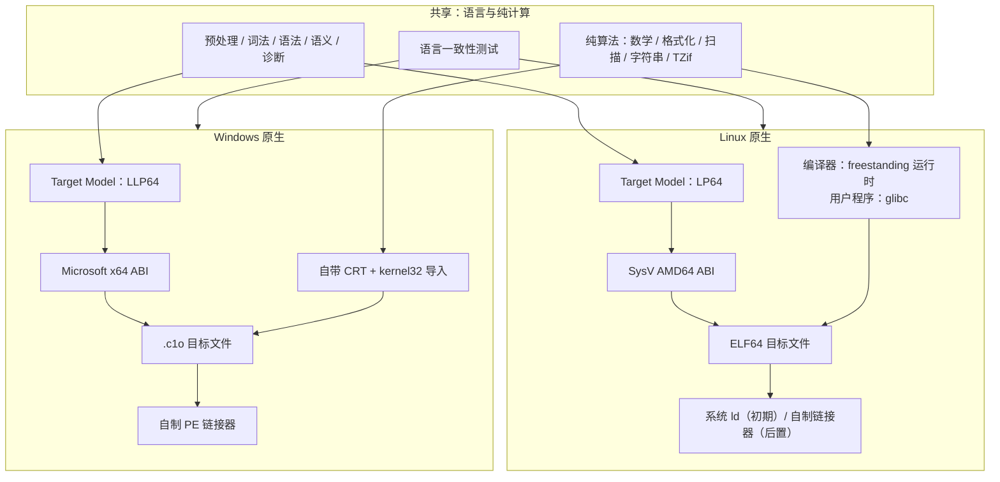
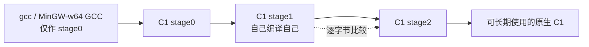

# BitKindle Native

> 以自举为目标的 C 工具链，Linux 与 Windows 各自原生发展。  
> 状态：M1 SysV 自举（`stage1` = `stage2`）+ M2 hosted glibc 路径已打通 · 整数/浮点/聚合/80-bit long double 已支持；packed/边界头待补 · 暂定名

本项目受 [tombkeeper/BitKindle](https://github.com/tombkeeper/BitKindle) 启发，把“从零构建自己的 C 工具链”这一目标带到 Linux，同时保留 Windows 的原生实现。两个平台共享语言前端、纯算法和语言测试；不共享 ABI、运行时、目标文件格式和链接器。

**不是跨平台编译器，不做翻译层，不追求二进制或目标文件互通。**

---

## 这是什么

- **Linux 原生工具链**：目标为 SysV AMD64 ABI、ELF64；用户程序默认链接 glibc，使用系统链接器；编译器自身 freestanding，自举后不依赖外部 C 编译器。
- **Windows 原生工具链**：目标为 Microsoft x64 ABI、PE32+；自带 CRT、自制 `.c1o` 目标格式和 PE 链接器；按 ABI 调用 DLL，不接 MinGW 构建生态。
- **共享核心**：C 预处理、词法、语法、语义、诊断、纯算法（数学、格式化、扫描、字符串、TZif）和语言测试。
- **最终目标**：两个平台各自完成自举——`stage1` 与 `stage2` 逐字节一致，构建自身不再需要外部 C 编译器。

## 不是什么

本项目明确不做以下事情：

- 不做 Linux ↔ Windows 的交叉编译。
- 不做 Wine / Proton / WSL / 任何翻译层。
- 不承诺 Linux 与 Windows 的二进制、目标文件、ABI 或运行时兼容。
- 不把两个平台的差异抽象成一套“统一 OS 层”。
- 不提供 Linux 上运行 Windows 二进制的能力；现成 Windows 程序由 Windows 自己运行。
- 不支持 C++ ABI、STL、异常，也不以编译 C++ 游戏引擎为目标。
- Windows 侧不接 COFF、`.lib`/`.a`、MinGW CRT、Windows SDK 头；只保证 DLL 导出 ABI 级兼容。
- 不承诺直接编译使用 GNU/MSVC 扩展的任意现有项目；需要时按库提供最小 ABI 头或手写原型。
- 不以“替换平台 libc/链接器”为第一目标。

## 为什么分开

两个平台对不齐不是工程量问题，而是模型冲突：

- **类型模型**：Linux x86-64 是 LP64，Windows x64 是 LLP64；`long` 的宽度不同，`wchar_t` 分别是 32/16 位，`long double` 的格式和精度不同，`va_list` 的实现不同。
- **OS 对象模型**：`fd` 对 `HANDLE`，`fork+exec` 对 `CreateProcess`，POSIX signal 对 SEH，UTF-8 字节路径对 UTF-16，文本/二进制模式不同，`errno` 对 `GetLastError`。
- **装载与链接模型**：ELF + PLT/GOT + `ld.so` + TLS + 符号版本，对 PE/COFF + IAT + Windows loader。
- **标准本身**：C 标准保留了大量 implementation-defined 行为，所谓“完全对齐”没有唯一答案。

几十年的桥接方案——Cygwin、Wine、WSL1、MinGW 的 POSIX 层、Windows NT 的 POSIX 子系统——都只能做到“模拟”或“部分兼容”。本项目不重复这条路。

**结论：共享语言，不共享平台。**

## 平台路线

| | Linux x86-64 | Windows x86-64 |
| --- | --- | --- |
| 定位 | 新增原生实现 | 上游参考实现，冻结后演进 |
| ABI | SysV AMD64 | Microsoft x64 |
| 数据模型 | LP64 | LLP64 |
| 可执行格式 | ELF64 | PE32+ |
| 用户程序标准库 | glibc（hosted） | 自带 CRT |
| 链接 | 自制 `c1link`（Python 原型 bootstrap）；hosted 测试仍用系统 `ld` | 自制 PE 链接器 |
| 编译器自身 | freestanding（syscall + 自带最小运行时） | freestanding（kernel32 导入 + 自带运行时） |
| 升级路径 | gcc stage0 → C1 自举 → 纯种子链（并行） | 现有 BitKindle 链 → 自举 |
| 第三方库 | `.so` ABI 级调用 | DLL 导出 ABI 级调用（含 MinGW 编出的 DLL） |

Linux 与 Windows 不需要对称。对称本身就是另一种“什么都想要”。

## 架构一览



## 共享边界

**共享（必须与 OS 无关）：**

- 预处理、词法、语法、语义、AST、诊断、常量求值。
- 纯算法：整数/浮点数学、`printf`/`scanf` 核心、字符串/内存操作、TZif 解析。
- C 语言测试用例、编译失败用例、差分测试语料。
- 编译器内部的纯数据结构和工具代码。

**分叉（平台原生）：**

- 目标数据模型、ABI、调用约定、结构体分类、varargs。
- 启动代码、入口、系统调用/系统库、进程/时间/环境/控制台。
- 目标文件写出、可执行文件写出、导入表、链接器。
- 标准库的平台实现、平台头文件、类型定义。
- 构建驱动、测试驱动、期望输出、CI。

**原则：**

- 不在共享代码里堆 `#ifdef`。需要平台差异时，分叉文件。
- 共享是收益，不是目标。某个文件为了“两边都能用”开始变形，就让它分叉。
- 唯一必须对齐的是 C 语言语义和语言测试；其余差异写进文档。

## 自举路线



- **stage0** 可以使用平台原生 C 编译器，这是允许的“前期依赖”。
- **stage1** 由 C1 自己编译；**stage2** 再编译一次；要求 stage1 与 stage2 逐字节一致。
- 自举完成后，构建 C1 不再需要 gcc/MinGW GCC。
- Linux freestanding 链已改用自制 `c1link`：gcc/ld 只负责构建最初的 bootstrap c1link，stage0/stage1/stage2 和 hello 由 c1link 链接。hosted glibc 测试仍使用系统 `ld`。
- Linux 的纯种子链（ELF seed → A0 → A1 → C0 → C1）与 gcc stage0 路线并行推进：`bootstrap/linux/seed.S` 是手写十六进制解码器，`seed.hex` 可复现 `seed.elf`，`seed.elf` 可复现 `a0.seed.elf`；Linux A1 参考实现和 freestanding 本体已完成，A0 可复现 `a1.seed.elf`；最小 freestanding C0 已能把受限 C 编译成 A1 文本，A1 装配后运行 exit(42)；C0 已支持函数/局部变量/控制流/表达式/全局变量，并能把 `bootstrap.c` 编成 A1、由 A1 装配成 ELF；该 bootstrap ELF 已能运行并输出 PE，但输出与上游 c1-bridge 不一致，语义偏差待修；上游最小链只作为对照，不作为 Linux 最终 C1。
- Win64 PE C1 → SysV 桥接方案见 [技术设计 6.6](docs/DESIGN.md#66-win64-pe-c1--sysvlinux-c1-桥接)：`win32_runtime.c`（13 个符号）+ `pe2elf.py` 12 个 stub + 上游 C1 编译 `linux/compiler.c` + c1link 闭合 stage1/stage2。

## 能做什么 / 不能做什么

| 场景 | Linux | Windows |
| --- | --- | --- |
| 编译 C89 + 部分 C99 到原生可执行文件 | 计划支持 | 计划沿用上游能力 |
| 编译器自举 | 计划支持 | 计划沿用上游能力 |
| 调用平台动态库 | `.so`，ABI 级 | DLL，ABI 级 |
| 运行现成平台二进制 | 原生 Linux 程序 | 原生 Windows 程序 |
| 在 Linux 运行 Windows 二进制 | 不做 | — |
| 在 Windows 运行 Linux 二进制 | — | 不做 |
| 链接 MinGW `.a` / COFF / `.lib` | — | 不做 |
| 直接 include Windows SDK / GNU 扩展头 | — | 不做（按需最小头） |
| 编译 C++ / 游戏引擎 | 不做 | 不做 |
| 用工具链编 C + Win32/GDI 游戏 | — | 可行，上游 Mario 已验证 |
| 用工具链编 C + SDL/OpenGL 游戏 | 可行方向，需最小头/导入 | 可行方向，需最小头/导入 |

## 与上游 BitKindle 的关系

- 上游 BitKindle 是 Windows x64 项目：3,584 字节十六进制种子、A0/A1 装配器、C0 过渡编译器、自举 C1、自制 `.c1o` 目标文件、自制 PE 链接器和自带运行时。
- 上游明确不依赖 MSVC/GCC/Clang、Windows SDK 或外部链接器，也不支持 COFF `.obj/.lib`、通用 `windows.h`、DLL 生成。
- 本项目把上游的 Windows 实现作为**参考实现**和可移植算法/测试的来源；Linux 侧是新的原生实现。
- 本项目不是上游的官方分支，与上游作者无隶属关系。上游代码与文档按 MIT License 使用，保留版权与许可声明。

## 目录结构（当前）

```text
bit/
├── build.sh                   # Linux 自举构建入口
├── README.md
├── docs/
│   └── DESIGN.md              # 技术设计
├── linux/
│   ├── compiler.c             # 移植后的 C1 编译器主体
│   ├── elf-output.c           # ELF64 可重定位对象写出
│   ├── linker.c               # C1 编译的静态 ELF 链接器
│   ├── runtime.c              # freestanding 运行时 / 12 个平台符号
│   ├── linuximports.h         # 编译器使用的运行时声明
│   ├── startup-sysv.S         # SysV 入口（gcc stage0 与 C1 共用）
│   ├── syscalls-sysv.S        # SysV syscall stub
│   ├── link-hosted.sh         # crt1/crti + glibc + crtn 链接
│   └── link-shared.sh         # C1 对象 -> .so
├── include/
│   ├── stdarg.h               # SysV va_list / va_start / va_arg
│   ├── stddef.h
│   ├── stdint.h
│   ├── inttypes.h
│   ├── stdbool.h
│   ├── complex.h
│   ├── wchar.h
│   ├── wctype.h
│   ├── poll.h
│   ├── getopt.h
│   ├── fnmatch.h
│   ├── pwd.h
│   ├── grp.h
│   ├── netdb.h
│   ├── regex.h
│   ├── iconv.h
│   ├── glob.h
│   ├── limits.h
│   ├── float.h
│   ├── assert.h
│   ├── stdio.h
│   ├── stdlib.h
│   ├── string.h
│   ├── ctype.h
│   ├── math.h
│   ├── dlfcn.h
│   ├── errno.h
│   ├── setjmp.h
│   ├── time.h
│   ├── fcntl.h
│   ├── unistd.h
│   ├── signal.h
│   ├── dirent.h
│   ├── pthread.h
│   └── sys/
│       ├── types.h
│       ├── stat.h
│       ├── time.h
│       ├── wait.h
│       ├── socket.h
│       ├── un.h
│       ├── epoll.h
│       ├── inotify.h
│       ├── eventfd.h
│       ├── timerfd.h
│       ├── signalfd.h
│       ├── memfd.h
│       └── select.h
├── netinet/
│   └── in.h
├── shared/
│   ├── README.md
│   ├── sources.json
│   ├── float_parse.c
│   └── diagnostic.c
├── bootstrap/
│   ├── README.md
│   ├── from-seed.sh           # 无 gcc/ld 的 seed bundle 自举
│   ├── minimal-chain.sh       # 上游 seed -> A0 -> A1 -> C0 -> C1
│   ├── make-seed.sh
│   ├── seed.sha256
│   ├── seed-*.hex
│   └── linux/                 # 零依赖 Linux 自举树
│       ├── seed.S             # 手写十六进制解码器
│       ├── seed.elf           # 种子可执行文件
│       ├── seed.hex           # seed.elf 的原始十六进制
│       └── a0/                # A0 契约、参考实现、汇编本体和测试
├── windows/
│   ├── README.md
│   ├── upstream.lock
│   └── upstream/              # 冻结的上游 Windows 参考树
├── tools/
│   ├── check_sources.py
│   ├── elflink.py             # 自制静态 ELF 链接器原型
│   └── pe2elf.py              # 上游 PE seed/工具 -> Linux ELF 运行
├── examples/
│   └── hello.c
├── tests/
│   ├── run.sh
│   ├── run-hosted.sh
│   ├── run-interop.sh
│   ├── run-env.sh
│   ├── run-linker.sh
│   ├── run-selflink.sh
│   ├── run-linker-selfhost.sh
│   ├── run-static-pie.sh
│   ├── run-archive.sh
│   ├── run-shared.sh
│   ├── run-dynamic.sh
│   ├── shlib/                  # C1 对象 -> .so 测试
│   ├── dynamic/                # C1 动态可执行文件测试
│   ├── sysv/                  # SysV ABI/语言回归测试
│   ├── hosted/                # glibc hosted 互操作测试
│   ├── interop/               # C1 <-> gcc ABI 双向互操作测试
│   └── reject/                # 明确拒绝的未实现特性
├── LICENSE
└── NOTICE
```

共享前端、hosted 运行时、Windows 目录等仍按设计逐步加入。

## 路线图

| 阶段 | 内容 | 状态 |
| --- | --- | --- |
| M0 | 项目介绍、技术设计、平台契约、共享/分叉清单 | 已完成 |
| M1 | Linux freestanding：gcc stage0、SysV ABI、ELF `.o`、系统 `ld`、hello、自举 | 进行中：`stage1` = `stage2`、整数/指针/浮点（含 NaN）/varargs/聚合/80-bit long double/packed/_Complex long double/32-bit wchar_t 与宽字符串已通过；纯种子链待补 |
| M2 | Linux hosted：glibc、`.so` 调用、`dlopen`、互操作测试 | 进行中：非 PIE + PIE crt/glibc 链接（含 crtbegin/crtend）、最小 hosted 头、`malloc`/`strlen`/`puts`/`printf`/`vprintf`/`dlopen`+`dlsym`/`errno`/`fopen`/`assert`/`setjmp`/`time`/`inttypes`/POSIX I/O/`strtol`/signal/qsort/atexit/stat/dirent/pthread（含 mutex/cond）/扩展 libc/math/wchar/wctype/gettimeofday/fork+waitpid/socketpair/TCP/UNIX sockets/select/poll/epoll/inotify/eventfd/timerfd/signalfd/memfd/mmap/uname/getopt/fnmatch/pwd/grp/getaddrinfo/getrlimit/getrandom/regex/iconv/glob/ioctl/statvfs/getauxval 已通过；更多头/边界待完成 |
| M3 | 共享层抽取、Windows 参考实现冻结、防漂移检查 | 进行中：已抽取 `shared/float_parse.c`、`shared/diagnostic.c`，加入边界/来源/PE 检查，并导入冻结的上游 Windows 参考树；其余共享前端抽取和 Windows ABI 测试待做 |
| M4 | Windows ABI 加固：varargs、结构体、`long double`、第三方 DLL | 计划 |
| M5 | 可选：自制 ELF 链接器、纯种子链、PIC/PIE、更多系统头 | 进行中：无 gcc/ld 的 transitional seed bundle 自举已完成、seed 文件有 SHA-256 校验且 seed compiler 是不动点；上游最小 seed→A0/A1→C0→C1 链已能在 Linux 上跑通（产物仍是 Windows C1，仅作对照）；零依赖 Linux 树已有手写 seed 解码器：`seed.hex` 复现 `seed.elf`，`seed.elf` 复现 `a0.seed.elf`；A0 的 C 参考实现与 syscall-only 汇编本体已逐字节一致，`smoke.a0` 生成双 PT_LOAD ELF 并以 42 退出；Linux A1 参考实现和 freestanding 本体已完成，A0 可复现 `a1.seed.elf`；最小 freestanding C0 已能把受限 C 编译成 A1 文本，A1 装配后运行 exit(42)；C0 已支持函数/局部变量/控制流/表达式/全局变量，并能把 `bootstrap.c` 编成 A1、由 A1 装配成 ELF；该 bootstrap ELF 已能运行并输出 PE，但输出与上游 c1-bridge 不一致，语义偏差待修；Win64 C1 → SysV 桥接已完成：`bootstrap/bridge.sh` 用上游 C1 产出 SysV stage1/stage2，`stage1 == stage2`；仍依赖上游 seed/PE 链接器，尚未零依赖；c1link 链接 stage0/stage1/stage2/hello，支持 `.a` 选择性抽取、节表/符号表、静态 PIE、`--shared` `.so` 和 C1 动态可执行文件。hosted glibc 测试仍用系统 `ld` |

## 快速开始

当前 Linux 自举链：

```bash
./build.sh
```

脚本会构建 gcc stage0，产出 `build/c1-stage0`、`build/c1-stage1`、`build/c1-stage2`，并检查：

- `compiler1.o` 与 `compiler2.o` 逐字节一致；
- `runtime1.o` 与 `runtime2.o` 逐字节一致；
- `c1-stage1` 与 `c1-stage2` 逐字节一致；
- `examples/hello.c` 可编译、链接并运行；
- `tests/sysv/*.c` 的整数/浮点寄存器与栈参数、LP64/`stdint.h`/`limits.h`、预定义目标宏、函数指针、全局初始化、递归、varargs/va_list 等测试通过；
- `tests/hosted/*.c` 通过系统 crt + glibc 运行，覆盖 c1link `--shared` 生成的 C1 `.so` 被 `dlopen`，以及 `malloc`/`strlen`/`puts`/`printf`/`vprintf`/`dlopen`+`dlsym`/`errno`/`fopen`；
- `tests/interop/` 验证 C1 与 gcc 在整数/浮点聚合（含 8/12/16 字节与 >16 字节内存类）上的双向 ABI 互操作；
- `tests/reject/` 验证未实现的 `__int128` 会明确报错；`tests/run-env.sh` 验证 `C1_INCLUDE`/`C1_STANDARD` 在仓库外可用。

Windows 侧仍沿用上游构建方式，尚未整合进本仓库。

## 文档

- [技术设计](docs/DESIGN.md)：平台契约、ABI、对象/链接、运行时、自举、测试、风险和决策记录。

## 许可证

本项目采用 [Apache License 2.0](LICENSE)。  
上游 BitKindle 的代码与文档按 MIT License 使用，版权归其贡献者所有；相关归属与 MIT 许可文本见 [NOTICE](NOTICE)。
