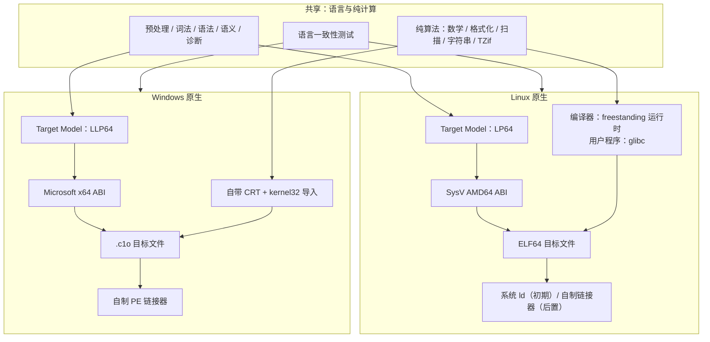
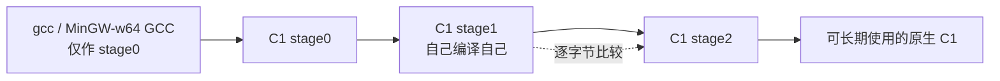

# BitKindle Native

> 以自举为目标的 C 工具链，Linux 与 Windows 各自原生发展。  
> 状态：设计阶段（v0.1）· 暂定名 · 尚未开始实现

本项目受 [tombkeeper/BitKindle](https://github.com/tombkeeper/BitKindle) 启发，把“从零构建自己的 C 工具链”这一目标带到 Linux，同时保留 Windows 的原生实现。两个平台共享语言前端、纯算法和语言测试；不共享 ABI、运行时、目标文件格式和链接器。

**不是跨平台编译器，不做翻译层，不追求二进制或目标文件互通。**

---

## 这是什么

- **Linux 原生工具链**：目标为 SysV AMD64 ABI、ELF64；用户程序默认链接 glibc，使用系统链接器；编译器自身 freestanding，自举后不依赖外部 C 编译器。
- **Windows 原生工具链**：目标为 Microsoft x64 ABI、PE32+；自带 CRT、自制 `.c1o` 目标格式和 PE 链接器；按 ABI 调用 DLL，不接 MinGW 构建生态。
- **共享核心**：C 预处理、词法、语法、语义、诊断、纯算法（数学、格式化、扫描、字符串、TZif）和语言测试。
- **最终目标**：两个平台各自完成自举——`stage1` 与 `stage2` 逐字节一致，构建自身不再需要外部 C 编译器。

## 不是什么

本项目明确不做以下事情：

- 不做 Linux ↔ Windows 的交叉编译。
- 不做 Wine / Proton / WSL / 任何翻译层。
- 不承诺 Linux 与 Windows 的二进制、目标文件、ABI 或运行时兼容。
- 不把两个平台的差异抽象成一套“统一 OS 层”。
- 不提供 Linux 上运行 Windows 二进制的能力；现成 Windows 程序由 Windows 自己运行。
- 不支持 C++ ABI、STL、异常，也不以编译 C++ 游戏引擎为目标。
- Windows 侧不接 COFF、`.lib`/`.a`、MinGW CRT、Windows SDK 头；只保证 DLL 导出 ABI 级兼容。
- 不承诺直接编译使用 GNU/MSVC 扩展的任意现有项目；需要时按库提供最小 ABI 头或手写原型。
- 不以“替换平台 libc/链接器”为第一目标。

## 为什么分开

两个平台对不齐不是工程量问题，而是模型冲突：

- **类型模型**：Linux x86-64 是 LP64，Windows x64 是 LLP64；`long` 的宽度不同，`wchar_t` 分别是 32/16 位，`long double` 的格式和精度不同，`va_list` 的实现不同。
- **OS 对象模型**：`fd` 对 `HANDLE`，`fork+exec` 对 `CreateProcess`，POSIX signal 对 SEH，UTF-8 字节路径对 UTF-16，文本/二进制模式不同，`errno` 对 `GetLastError`。
- **装载与链接模型**：ELF + PLT/GOT + `ld.so` + TLS + 符号版本，对 PE/COFF + IAT + Windows loader。
- **标准本身**：C 标准保留了大量 implementation-defined 行为，所谓“完全对齐”没有唯一答案。

几十年的桥接方案——Cygwin、Wine、WSL1、MinGW 的 POSIX 层、Windows NT 的 POSIX 子系统——都只能做到“模拟”或“部分兼容”。本项目不重复这条路。

**结论：共享语言，不共享平台。**

## 平台路线

| | Linux x86-64 | Windows x86-64 |
| --- | --- | --- |
| 定位 | 新增原生实现 | 上游参考实现，冻结后演进 |
| ABI | SysV AMD64 | Microsoft x64 |
| 数据模型 | LP64 | LLP64 |
| 可执行格式 | ELF64 | PE32+ |
| 用户程序标准库 | glibc（hosted） | 自带 CRT |
| 链接 | 初期使用系统 `ld`，自制 ELF 链接器后置 | 自制 PE 链接器 |
| 编译器自身 | freestanding（syscall + 自带最小运行时） | freestanding（kernel32 导入 + 自带运行时） |
| 升级路径 | gcc stage0 → C1 自举 → 纯种子链（后置） | 现有 BitKindle 链 → 自举 |
| 第三方库 | `.so` ABI 级调用 | DLL 导出 ABI 级调用（含 MinGW 编出的 DLL） |

Linux 与 Windows 不需要对称。对称本身就是另一种“什么都想要”。

## 架构一览



## 共享边界

**共享（必须与 OS 无关）：**

- 预处理、词法、语法、语义、AST、诊断、常量求值。
- 纯算法：整数/浮点数学、`printf`/`scanf` 核心、字符串/内存操作、TZif 解析。
- C 语言测试用例、编译失败用例、差分测试语料。
- 编译器内部的纯数据结构和工具代码。

**分叉（平台原生）：**

- 目标数据模型、ABI、调用约定、结构体分类、varargs。
- 启动代码、入口、系统调用/系统库、进程/时间/环境/控制台。
- 目标文件写出、可执行文件写出、导入表、链接器。
- 标准库的平台实现、平台头文件、类型定义。
- 构建驱动、测试驱动、期望输出、CI。

**原则：**

- 不在共享代码里堆 `#ifdef`。需要平台差异时，分叉文件。
- 共享是收益，不是目标。某个文件为了“两边都能用”开始变形，就让它分叉。
- 唯一必须对齐的是 C 语言语义和语言测试；其余差异写进文档。

## 自举路线



- **stage0** 可以使用平台原生 C 编译器，这是允许的“前期依赖”。
- **stage1** 由 C1 自己编译；**stage2** 再编译一次；要求 stage1 与 stage2 逐字节一致。
- 自举完成后，构建 C1 不再需要 gcc/MinGW GCC。
- Linux 初版保留系统 `ld` 作为链接依赖；这与 Rust 早期/当前使用系统链接器的做法一致。自制链接器是可选的后续目标。
- Linux 的纯种子链（ELF seed → A0 → A1 → C0 → C1）是后置目标，不在第一版阻塞自举。

## 能做什么 / 不能做什么

| 场景 | Linux | Windows |
| --- | --- | --- |
| 编译 C89 + 部分 C99 到原生可执行文件 | 计划支持 | 计划沿用上游能力 |
| 编译器自举 | 计划支持 | 计划沿用上游能力 |
| 调用平台动态库 | `.so`，ABI 级 | DLL，ABI 级 |
| 运行现成平台二进制 | 原生 Linux 程序 | 原生 Windows 程序 |
| 在 Linux 运行 Windows 二进制 | 不做 | — |
| 在 Windows 运行 Linux 二进制 | — | 不做 |
| 链接 MinGW `.a` / COFF / `.lib` | — | 不做 |
| 直接 include Windows SDK / GNU 扩展头 | — | 不做（按需最小头） |
| 编译 C++ / 游戏引擎 | 不做 | 不做 |
| 用工具链编 C + Win32/GDI 游戏 | — | 可行，上游 Mario 已验证 |
| 用工具链编 C + SDL/OpenGL 游戏 | 可行方向，需最小头/导入 | 可行方向，需最小头/导入 |

## 与上游 BitKindle 的关系

- 上游 BitKindle 是 Windows x64 项目：3,584 字节十六进制种子、A0/A1 装配器、C0 过渡编译器、自举 C1、自制 `.c1o` 目标文件、自制 PE 链接器和自带运行时。
- 上游明确不依赖 MSVC/GCC/Clang、Windows SDK 或外部链接器，也不支持 COFF `.obj/.lib`、通用 `windows.h`、DLL 生成。
- 本项目把上游的 Windows 实现作为**参考实现**和可移植算法/测试的来源；Linux 侧是新的原生实现。
- 本项目不是上游的官方分支，与上游作者无隶属关系。上游代码与文档按 MIT License 使用，保留版权与许可声明。

## 目录结构（规划）

```text
bit/
├── README.md                  # 本文件
├── docs/
│   └── DESIGN.md              # 技术设计
├── shared/
│   ├── frontend/              # 预处理、词法、语法、语义、诊断
│   ├── lib/                   # 纯算法
│   ├── include/               # 共享的抽象类型/接口
│   └── tests/                 # 语言一致性测试
├── linux/
│   ├── bootstrap/             # 未来的 ELF seed / A0 / A1 / C0
│   ├── target/                # LP64、SysV ABI 描述
│   ├── codegen/               # Linux 代码生成
│   ├── object/                # ELF64 目标文件
│   ├── runtime/               # freestanding 运行时；hosted 头/胶水
│   ├── startup/               # _start / crt 胶水
│   ├── driver/                # 原生构建驱动
│   └── tests/                 # 平台测试与期望
├── windows/
│   ├── bootstrap/             # 上游 seed / A0 / A1 / C0
│   ├── target/                # LLP64、Microsoft x64 ABI 描述
│   ├── codegen/               # Windows 代码生成
│   ├── object/                # .c1o 目标文件
│   ├── linker/                # 自制 PE 链接器
│   ├── runtime/               # 自带 CRT + kernel32 导入
│   ├── driver/                # PowerShell 驱动
│   └── tests/                 # 平台测试与期望
├── tools/                     # 同步检查、测试运行器、辅助脚本
└── tests/                     # 跨平台共享语料与编排
```

目录是设计基线，实施时可以调整；调整必须同步更新本文件与 `docs/DESIGN.md`。

## 路线图

| 阶段 | 内容 | 状态 |
| --- | --- | --- |
| M0 | 项目介绍、技术设计、平台契约、共享/分叉清单 | 进行中 |
| M1 | Linux freestanding：gcc stage0、SysV、ELF `.o`、系统 `ld`、hello、自举 | 计划 |
| M2 | Linux hosted：glibc、`.so` 调用、`dlopen`、互操作测试 | 计划 |
| M3 | 共享层抽取、Windows 参考实现冻结、防漂移检查 | 计划 |
| M4 | Windows ABI 加固：varargs、结构体、`long double`、第三方 DLL | 计划 |
| M5 | 可选：自制 ELF 链接器、纯种子链、PIC/PIE、更多系统头 | 后续 |

## 快速开始（规划）

以下命令尚未实现，仅用于说明未来的使用方式：

```bash
# Linux：从 stage0 构建并自举
./linux/build.sh bootstrap
./linux/build.sh self-host
./linux/build.sh test

# Linux：编译一个用户程序（hosted，链接 glibc）
./linux/build.sh compile examples/hello.c -o hello

# Windows：沿用上游构建方式
powershell.exe -NoProfile -ExecutionPolicy Bypass -File .\windows\build-all.ps1
```

## 文档

- [技术设计](docs/DESIGN.md)：平台契约、ABI、对象/链接、运行时、自举、测试、风险和决策记录。

## 许可证

本项目采用 [Apache License 2.0](LICENSE)。  
上游 BitKindle 的代码与文档按 MIT License 使用，版权归其贡献者所有；相关归属与 MIT 许可文本见 [NOTICE](NOTICE)。
