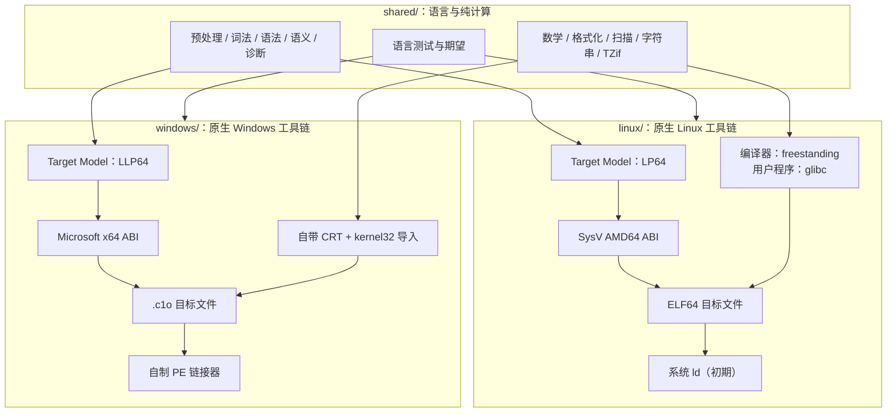
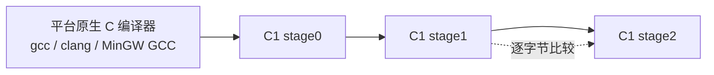

# BitKindle Native 技术设计

- 版本：0.1（设计基线）
- 状态：M1 SysV 自举 + M2 hosted glibc 路径已打通；long double/packed/PIE 待补
- 日期：2026-10-21
- 适用范围：Linux x86-64 与 Windows x86-64 两条原生工具链
- 上游参考：[tombkeeper/BitKindle](https://github.com/tombkeeper/BitKindle)

---

## 0. 文档目的

本文定义 BitKindle Native 的技术基线，回答以下问题：

1. 两个平台分别做什么、不做什么。
2. 哪些代码共享，哪些必须分叉。
3. 每个平台的目标 ABI、数据模型、对象格式、链接方式和运行时边界。
4. 编译器如何自举，前期依赖如何退出。
5. 构建、测试、发布和防漂移机制。
6. 已知风险、非目标和待定问题。

本文是设计文档，不是使用手册。代码尚未开始，文中出现的命令和目录是规划。

---

## 1. 背景与约束

### 1.1 上游 BitKindle 的事实

上游 BitKindle 是一个 Windows x64 项目：

- 从 3,584 字节十六进制机器码种子开始，逐级构建 A0/A1 装配器、C0 过渡编译器、自举 C1、自制 PE 链接器和运行库。
- 构建不依赖 MSVC、GCC、Clang、Windows SDK 或外部链接器（上游 `README.zh-CN.md`）。
- 目标文件是自制 `.c1o`，不接收 COFF `.obj` 或 SDK `.lib`，不提供通用 `windows.h`，链接器只生成 EXE、不生成 DLL（上游 `USAGE.zh-CN.md`）。
- 运行时是自带的，不是 msvcrt/ucrt；通过 39 个 kernel32 API 的导入表访问 Windows。
- 通用 Windows SDK 头、COFF `.obj/.lib`、外部工具链兼容不在上游范围内。
- 上游 Mario 示例证明：C + Win32/GDI 可以构建出可玩的 Windows 游戏。

上游的 Windows 实现是本项目的参考实现，也是可移植算法、诊断和测试的来源。

### 1.2 设计约束

本项目遵循以下约束：

1. **Linux 与 Windows 分开发展。** 不做交叉编译，不做翻译层，不追求二进制、目标文件或 ABI 互通。
2. **不抛弃各自平台的成熟生态。** Linux 侧使用 SysV ABI、ELF、glibc 和系统链接器；Windows 侧使用 Microsoft x64 ABI、PE 和 Win32 DLL。
3. **平台 ABI 兼容即可。** 能按平台 ABI 调用系统库；不承诺直接解析 glibc/Windows SDK/MinGW 官方头，不承诺任意现有源码不改即可编译。
4. **编译器自身保持 freestanding。** 自举后的编译器不依赖外部 C 编译器，也不把平台 libc 链进自己。
5. **前期依赖允许存在。** gcc/clang/MinGW GCC 可以作为 stage0；系统 `ld` 可以作为初期的链接依赖。最终目标是自举，而不是第一天就消灭所有外部工具。
6. **共享语言，不共享平台。** 只共享与 OS 无关的前端、纯算法和语言测试；ABI、运行时、对象格式、链接器、构建驱动各自实现。
7. **不为“对齐”而牺牲正确性。** 平台差异写入文档和测试，不用统一抽象层掩盖。

### 1.3 关键结论

- **两个独立的原生工具链**，共享 C 语言前端和纯算法。
- **Linux**：SysV AMD64 / LP64 / ELF64；用户程序 hosted 链接 glibc；编译器自身 freestanding；初期使用系统 `ld`。
- **Windows**：Microsoft x64 / LLP64 / PE32+；自带 CRT、自制 `.c1o` 和 PE 链接器；DLL ABI 级兼容，不接 MinGW 构建生态。
- **自举**：stage0 可用原生编译器；stage1 由 C1 编译自身；stage2 再编译一次；stage1 与 stage2 逐字节一致。
- **不做**：统一 OS 层、双 target 编译器、双 profile、COFF/.a/MinGW CRT、C++ ABI、Wine/WSL/Proton。

---

## 2. 术语

| 术语 | 含义 |
| --- | --- |
| 上游 | tombkeeper/BitKindle 仓库及其 Windows x64 实现 |
| 本项目 | BitKindle Native，Linux 与 Windows 两条原生工具链的合称 |
| freestanding | 不链接平台 C 运行时，使用自带的启动代码和最小运行时 |
| hosted | 链接平台标准 C 运行时；Linux 侧指 glibc |
| stage0 | 用平台原生 C 编译器构建出的第一版 C1，只用于启动自举 |
| stage1 | 由 stage0 编译 C1 源码得到的编译器 |
| stage2 | 由 stage1 编译同一份 C1 源码得到的编译器 |
| 自举 | stage1 与 stage2 逐字节一致，构建自身不再需要外部 C 编译器 |
| `.c1o` | 上游自制的目标文件格式，供自制 PE 链接器使用 |
| target model | 编译器的目标数据模型：类型宽度、对齐、`wchar_t`、`long double`、`va_list` 等 |
| ABI 兼容 | 调用约定、类型模型、符号、重定位、动态库调用等二进制层兼容 |
| 源码兼容 | 能直接解析官方头文件、扩展语法并编译现有源码；本项目不承诺 |
| E1/E2/E3 | ABI/装载级、系统头/扩展级、原生对象/库/构建集成级；本项目先做 E1 |
| CRT | C 运行时，包括启动、stdio、malloc、errno、locale 等 |

---

## 3. 总体架构

### 3.1 两条独立产品线



### 3.2 分层

| 层 | 职责 | 共享策略 |
| --- | --- | --- |
| 语言前端 | 预处理、词法、语法、语义、AST、诊断、常量求值 | 共享 |
| 目标模型 | 类型宽度/对齐、`wchar_t`、`long double`、`va_list`、预定义宏 | 分叉 |
| 代码生成 | 指令选择、寄存器分配、栈帧、调用序列 | 框架共享，ABI 部分分叉 |
| 对象写出 | ELF64 `.o` / `.c1o` | 分叉 |
| 链接 | 系统 `ld` / 自制 PE 链接器 | 分叉 |
| 运行时 | 启动、文件/内存/时间/进程/环境、libc 子集 | 分叉 |
| 驱动 | 构建编排、测试运行、发布 | 分叉 |
| 测试 | 语言一致性、ABI、互操作、自举 | 语料共享，期望分平台 |

### 3.3 共享与分叉原则

1. **共享代码不得包含 OS 头、平台类型或平台条件编译。**
2. 需要平台差异时，优先分叉文件，而不是在共享文件里增加 `#ifdef`。
3. 共享是收益，不是目标。分叉的成本低于维护一个泄漏的抽象层。
4. 唯一必须保持一致的契约是 C 语言语义和语言测试结果（implementation-defined 部分除外）。
5. 平台之间不做对称性要求。Linux 用 glibc、Windows 用自带 CRT 是刻意的不对称。

---

## 4. 平台契约

### 4.1 Linux x86-64

#### 4.1.1 目标数据模型

采用 System V AMD64 psABI 的 LP64 模型。

| 类型 | 大小（字节） | 对齐（字节） | 说明 |
| --- | --- | --- | --- |
| `char` | 1 | 1 | 有符号 |
| `short` | 2 | 2 | 有符号 |
| `int` | 4 | 4 | 有符号 |
| `long` | 8 | 8 | LP64 |
| `long long` | 8 | 8 | 有符号 |
| 指针 | 8 | 8 | |
| `size_t` | 8 | 8 | 无符号 |
| `ptrdiff_t` | 8 | 8 | 有符号 |
| `wchar_t` | 4 | 4 | 有符号 `int` |
| `float` | 4 | 4 | IEEE 754 binary32 |
| `double` | 8 | 8 | IEEE 754 binary64 |
| `long double` | 16 | 16 | x87 80-bit 扩展精度 |
| `_Bool` | 1 | 1 | |
| `enum` | 4 | 4 | 能放入 `int` 时；超出范围的行为另行定义 |
| `va_list` | 24 | 8 | `__va_list_tag[1]` 结构 |

结构体/联合体按自然对齐；位域布局遵循本编译器定义并在测试中固化；`#pragma pack` 的支持范围单独记录。

#### 4.1.2 调用约定

- 整数/指针参数：`RDI`、`RSI`、`RDX`、`RCX`、`R8`、`R9`，之后走栈。
- 浮点参数：`XMM0`–`XMM7`，之后走栈。
- 返回值：整数/指针在 `RAX`（必要时 `RDX`）；浮点在 `XMM0`（必要时 `XMM1`）；大结构体通过隐藏指针返回。
- 栈对齐：调用前 `RSP % 16 == 0`；函数入口 `RSP % 16 == 8`。
- 红区：128 字节，叶子函数可使用；跨信号/中断边界不得依赖。
- 被调用者保存：`RBX`、`RBP`、`R12`–`R15`；`RSP` 由调用约定维护。
- 调用者保存：`RAX`、`RCX`、`RDX`、`RSI`、`RDI`、`R8`–`R11`；所有 `XMM` 寄存器。
- 可变参数：`AL` 存放使用的向量寄存器数量；`va_list` 使用寄存器保存区和溢出区。
- x87：调用边界要求 x87 栈为空（`long double` 返回值除外）。
- 结构体分类：按 psABI 的 eightbyte 规则分为 INTEGER/SSE/MEMORY；大于 16 字节、含未对齐字段或特殊成员时走内存。

具体细节以 System V AMD64 psABI 为准；实现必须由 ABI 测试矩阵覆盖。

#### 4.1.3 ELF64 对象与链接

初始阶段：

- 编译器输出 **ELF64 可重定位目标文件**，不直接输出可执行文件。
- 目标文件包含 `.text`、`.data`、`.bss`、`.rodata`、`.symtab`、`.strtab`、`.rela.*`、`.note.GNU-stack` 等标准节。
- 重定位至少覆盖：`R_X86_64_64`、`R_X86_64_PC32`、`R_X86_64_PLT32`、`R_X86_64_32`、`R_X86_64_32S`、`R_X86_64_GOTPCREL`；后续按需要扩展。
- 外部函数调用使用 `PLT32`，由系统 `ld` 生成 PLT；外部数据使用 GOT 或由 `ld` 处理的拷贝重定位。
- 初期采用非 PIE 的 `ET_EXEC`，避免一开始实现完整 PIC；PIE/PIC 后置。
- 链接由系统 `ld` 完成：
  - 编译器自身：`ld -nostdlib -static -no-pie` + 自带 `_start` + 自带运行时。
  - 用户程序（hosted）：`crt1.o/crti.o/crtn.o` + glibc + 动态链接器 + 项目提供的 ABI 头/原型。
- 系统 `ld` 是初期的唯一外部链接依赖。自制 ELF 链接器是可选后续目标：
  - 先做静态链接；
  - 再做动态链接（`PT_INTERP`、`.dynamic`、`.dynsym/.dynstr`、`.rela.dyn/.rela.plt`、PLT/GOT、GNU hash、符号版本、TLS、init/fini）。

#### 4.1.4 启动与运行时

存在两个明确分开的运行时上下文：

| 上下文 | 运行时 | 启动 | 是否链 glibc |
| --- | --- | --- | --- |
| 编译器自身 | 自带最小运行时 + Linux syscall | 自带 `_start` | 否 |
| 用户程序（hosted） | glibc | `crt1.o` → `__libc_start_main` | 是 |

**编译器自身（freestanding）：**

- 需要的最小 syscall 集合：`read`、`write`、`openat`、`close`、`lseek`、`fstat`、`mmap`、`munmap`、`exit_group`、`clock_gettime` 等；按实际实现裁剪。
- 内存分配可用 `mmap`/`munmap` 实现，不依赖 `brk`。
- `argc/argv/envp` 由 `_start` 从初始栈解析，传给 C 入口。
- 不依赖 TLS；若后续需要，再引入 `arch_prctl(ARCH_SET_FS)` 和 TCB。
- `_start` 和 syscall 胶水需要用汇编或等价的机器码 stub 实现。由于 C1 暂不支持内联汇编，初期可以由 gcc 汇编一个 `crt0.S`/`syscall.S` 生成目标文件；自举阶段复用该目标文件，或由项目自己的 A0/A1 生成。该 stub 必须进入种子/引导清单并做哈希校验。是否给 C1 增加 syscall 内建是待定问题。

**用户程序（hosted）：**

- 使用 glibc 的启动文件和 `__libc_start_main`，不要用编译器自身的 `_start`。
- 用户程序的 `malloc`、`stdio`、`errno`、locale、TLS 全部归 glibc；**不得**把自带 CRT 链进 hosted 程序。
- 项目提供 hosted ABI 头/原型子集，声明 `printf`、`malloc`、`fopen`、`dlopen` 等；这些头必须与 glibc 的类型/布局一致，但不承诺解析 glibc 官方头。
- 初始支持非 PIE；PIE/PIC 后置。
- 动态库调用通过 PLT/GOT；`dlopen/dlsym` 作为可选路径。

**边界规则：**

- 编译器进程与用户程序进程完全分离，不混用两套 libc。
- hosted 程序与第三方 `.so` 之间遵守库的分配/释放规则；不得用项目运行时释放 glibc 分配的内存。
- `long double` 在 Linux 侧是 80-bit，跨库边界按平台 ABI；不要假设与 Windows 一致。

### 4.2 Windows x86-64

#### 4.2.1 目标数据模型

采用 Microsoft x64 ABI 与上游 BitKindle 的类型模型。

| 类型 | 大小（字节） | 对齐（字节） | 说明 |
| --- | --- | --- | --- |
| `char` | 1 | 1 | 有符号 |
| `short` | 2 | 2 | 有符号 |
| `int` | 4 | 4 | 有符号 |
| `long` | 4 | 4 | LLP64 |
| `long long` | 8 | 8 | 有符号 |
| 指针 | 8 | 8 | |
| `size_t` | 8 | 8 | 无符号 |
| `ptrdiff_t` | 8 | 8 | 有符号 |
| `wchar_t` | 2 | 2 | 无符号 16-bit |
| `float` | 4 | 4 | IEEE 754 binary32 |
| `double` | 8 | 8 | IEEE 754 binary64 |
| `long double` | 8 | 8 | 上游使用 binary64 |
| `_Bool` | 1 | 1 | |
| `enum` | 4 | 4 | 上游模型 |
| `va_list` | 8 | 8 | 字符指针 |

注意：MinGW-w64 GCC 的 `long double` 通常是 80-bit，而上游 BitKindle 是 binary64。调用 MinGW 编出的 DLL 时，**不要在边界使用 `long double`**；这是已知的 ABI 差异。

#### 4.2.2 调用约定

- 整数/指针参数：`RCX`、`RDX`、`R8`、`R9`，之后走栈。
- 浮点参数：`XMM0`–`XMM3`，之后走栈。
- 影子空间：调用者必须在栈上预留 32 字节；栈保持 16 字节对齐。
- 返回值：整数/指针在 `RAX`；浮点在 `XMM0`；1/2/4/8 字节结构体在 `RAX`；其他结构体通过隐藏指针返回。
- 被调用者保存：`RBX`、`RBP`、`RDI`、`RSI`、`R12`–`R15`、`XMM6`–`XMM15`。
- 调用者保存：`RAX`、`RCX`、`RDX`、`R8`–`R11`、`XMM0`–`XMM5`。
- 无红区。
- 可变参数：浮点值同时放入对应的整数寄存器和影子空间；`va_list` 是 `char *`。
- 结构体传递/返回遵循 Microsoft x64 ABI；大于 8 字节的结构体按引用传递，具体规则由 ABI 测试固化。

#### 4.2.3 PE32+、`.c1o` 与链接

- 目标文件：延续上游 `.c1o` 格式（节、符号、重定位）。
- 链接器：延续上游自制 PE 链接器。
- 输出：PE32+ EXE；支持 console/GUI 子系统；**不生成 DLL**。
- 映像基址：初期固定 `0x400000`；节对齐 4 KiB 虚拟 / 512 字节文件。
- 导入：import descriptor + ILT + IAT；支持按导出名和序号导入；`--import symbol DLL export|#ordinal`。
- 初期不生成基址重定位、不生成 `.pdata/.xdata` 展开表；这会限制异常/栈展开穿过本工具链生成的帧，作为已知边界记录。
- 不接收 COFF `.obj`、`.lib`、`.a`；不解析 import library；不做 `dlltool` 兼容。
- 不提供通用 `windows.h`；第三方 DLL 用项目提供的最小声明或手写原型。

#### 4.2.4 启动与运行时

- 编译器自身和用户程序都使用**自带 CRT**，不链 msvcrt/ucrt。
- 入口为 `__c1_start`：初始化、调用 `main(argc, argv)`、保存退出码、调用退出分发。
- 运行时通过 `__c1_win_*` 外部符号访问 kernel32；链接器把它们绑定到 IAT。
- 上游 `runtime/imports.json` 的 39 个 API 作为基线；新增第三方 DLL 时增加 import 声明。
- 不提供 `__declspec(dllimport/dllexport)` 语义；不承诺数据导入；函数导入按名字/序号可用。
- 第三方 MinGW DLL 的边界规则：
  - 只调用导出的 C 函数；
  - 不跨 DLL 传递 `FILE*`、`errno`、项目分配的内存；
  - DLL 分配的指针用 DLL 自己的释放函数；
  - 不在边界使用 `long double`；
  - C++ 异常/SEH 不穿过本工具链生成的帧。

### 4.3 平台差异清单

| 维度 | Linux | Windows | 是否共享 |
| --- | --- | --- | --- |
| ABI | SysV AMD64 | Microsoft x64 | 否 |
| 数据模型 | LP64 | LLP64 | 否 |
| `wchar_t` | 32-bit 有符号 | 16-bit 无符号 | 否 |
| `long double` | 80-bit | 64-bit（上游） | 否 |
| `va_list` | 结构体数组 | `char *` | 否 |
| 可执行格式 | ELF64 | PE32+ | 否 |
| 目标文件 | ELF `.o` | `.c1o` | 否 |
| 链接 | 系统 `ld`（初期） | 自制 PE 链接器 | 否 |
| 用户程序 libc | glibc | 自带 CRT | 否 |
| 编译器自身 | freestanding + syscall | freestanding + kernel32 | 否 |
| 动态库 | `.so` PLT/GOT | DLL IAT | 否 |
| 启动 | `_start` / `crt1.o` | `__c1_start` | 否 |
| 构建驱动 | shell + Python | PowerShell | 否 |
| 语言前端 | 共享 | 共享 | 是 |
| 纯算法 | 共享 | 共享 | 是 |
| 语言测试语料 | 共享 | 共享 | 是 |

---

## 5. 编译器设计

### 5.1 前端

前端负责：

- 预处理：宏展开、条件编译、包含文件、`#pragma` 的受支持子集。
- 词法：标识符、字面量、字符/字符串、宽字符、通用字符名。
- 语法：C89 + 上游已支持的 C99 特性。
- 语义：类型检查、作用域、初始化、常量求值、诊断。
- AST/中间表示：沿用上游直接生成机器码的结构；若后续引入 IR，必须保证自举链可分阶段落地。

前端不得包含 OS 头、平台类型或平台条件编译。文件操作、内存分配、诊断输出通过一个**窄接口**访问平台层；该接口不是“统一 OS 抽象”，只覆盖编译器实际需要的少数原语。

### 5.2 目标模型

每个平台提供一份 target model 描述：

| 字段 | Linux | Windows |
| --- | --- | --- |
| 指针宽度 | 8 | 8 |
| `long` | 8 | 4 |
| `wchar_t` | 4，有符号 | 2，无符号 |
| `long double` | 80-bit，16 字节存储 | 64-bit，8 字节 |
| `va_list` | 结构体数组 | `char *` |
| 结构体对齐 | SysV 自然对齐 | Microsoft 自然对齐 |
| 预定义宏 | `__x86_64__`、`__linux__`、`__LP64__` 等 | `_WIN64`、`_M_X64`、`__MINGW64__`（按 MinGW 语义）等 |
| ABI | SysV | Microsoft x64 |
| 对象格式 | ELF64 | `.c1o` |

target model 是编译期选择，不是运行时切换。每个平台构建自己的编译器二进制，目标平台固定。

### 5.3 代码生成

- 指令选择、寄存器分配、栈帧布局、表达式求值等通用逻辑尽量共享。
- 与 ABI 相关的部分分叉：
  - 参数分配/读取；
  - 返回值/隐藏指针；
  - 结构体分类；
  - varargs 保存区；
  - 函数序言/尾声；
  - 栈对齐、影子空间/红区；
  - 调用/跳转的重定位类型；
  - 浮点/`long double` 约定。
- Windows 保留上游的直接机器码生成方式；Linux 按 SysV 规则实现。
- 不以优化为目标；正确性、可自举、可测试优先。

### 5.4 对象写出

**Linux ELF64：**

- 生成标准可重定位目标文件，供系统 `ld` 使用。
- 需要正确的节、符号表、字符串表、重定位表、对齐和 `.note.GNU-stack`。
- 初期非 PIE；后续增加 PIC/PIE。
- 对象写出必须做边界检查，防止溢出和超大输出。

**Windows `.c1o`：**

- 沿用上游格式和写出逻辑。
- 目标是自制 PE 链接器；不兼容 COFF。
- 不生成基址重定位和展开表（初期）。

### 5.5 链接与驱动

**Linux 驱动：**

- 负责调用 C1 编译源文件、调用系统 `ld` 链接、组织 include/library 路径。
- 编译器自身：`-nostdlib -static -no-pie` + 自带启动/运行时。
- 用户程序：`crt1.o/crti.o/crtn.o` + glibc + 动态链接器。
- 初期不依赖 `gcc` 作为链接驱动；直接调用 `ld`。需要发现 `crt*.o` 和 `libc.so` 的标准路径，找不到时给出明确诊断。
- 允许用环境变量覆盖路径，便于测试和交叉环境（但不做跨平台产物）。

**Windows 驱动：**

- 沿用上游 PowerShell 构建脚本。
- 调用 C1 生成 `.c1o`，调用自制 PE 链接器生成 EXE。
- 不调用 MSVC/MinGW 工具链。

**驱动职责边界：**

- 驱动不是自举的一部分；它可以用 Python/bash/PowerShell。
- 驱动不得把平台差异泄漏进编译器前端。
- 驱动必须使用参数数组而不是拼接 shell 字符串，避免注入和引用问题。

### 5.6 运行时与 libc 策略

| 上下文 | Linux | Windows |
| --- | --- | --- |
| 编译器自身 | 自带最小运行时 + syscall | 自带 CRT + kernel32 |
| 用户程序默认 | glibc | 自带 CRT + kernel32 |
| 第三方库 | `.so` 自带的依赖/glibc | DLL 自带的 msvcrt/ucrt |
| 是否混用 libc | 不得在同一进程混用项目 CRT 与 glibc | 不得在同一进程混用项目 CRT 与 msvcrt |

**规则：**

1. 编译器进程与用户程序进程分离，各自使用自己的运行时。
2. hosted Linux 程序的 `malloc/stdio/errno/locale/TLS` 全部归 glibc。
3. Windows 程序的对应功能归自带 CRT。
4. 与第三方库交互时，遵守库的所有权/释放规则；不跨 CRT 传递资源。
5. 项目提供的 hosted 头是 ABI 子集头，不是 glibc 官方头的替代品；官方头兼容（E2）后置。

### 5.7 诊断与错误处理

- 诊断码/类别共享；具体文本可以按平台调整。
- 同一平台内，编译失败测试可以比较精确诊断；跨平台只比较类别和退出码。
- 编译器不得因为非法输入崩溃、挂起或写出越界。
- 所有文件/内存/链接操作都要检查返回值；`errno`/`GetLastError` 映射到内部错误类别。

### 5.8 资源限制与健壮性

- 包含深度、宏展开深度/数量、单文件大小、输出大小、符号数量、重定位数量都要有上限。
- 上游的 64 MiB 输出上限、1024 字节路径等限制作为基线；Linux 可按需调整并测试。
- 递归下降解析器要防止栈溢出；必要时增加深度计数。
- 链接器/对象写出要做整数溢出检查。
- 驱动要有超时和清理逻辑，避免残留临时文件。

---

## 6. 自举设计

### 6.1 阶段定义



- **stage0**：允许使用平台原生 C 编译器。它只负责把 C1 源码编译成第一版可运行的编译器。
- **stage1**：由 stage0 编译得到；用它编译 C1 源码，得到 stage2。
- **stage2**：由 stage1 编译同一份源码得到。
- 验收：stage1 与 stage2 逐字节一致；两者都能通过语言/ABI 测试；构建 stage1/stage2 不再需要外部 C 编译器。

### 6.2 Linux 自举阶梯

1. **P0：stage0**
   - gcc/clang 编译 C1 源码 + 自带运行时 + `crt0.S`/`syscall.S`。
   - 链接：系统 `ld -nostdlib -static -no-pie`。
   - 不使用 glibc。
   - 产物：freestanding 的 `c1-stage0`。
2. **P1：stage1**
   - `c1-stage0` 编译 C1 源码，输出 ELF64 `.o`。
   - 系统 `ld` 链接 stage1（仍然 `-nostdlib`）。
   - 产物：freestanding 的 `c1-stage1`。
3. **P2：stage2**
   - `c1-stage1` 编译同一份源码，输出 `.o`。
   - 系统 `ld` 链接 stage2。
   - 比较 stage1/stage2；运行测试。
4. **P3：hosted 输出**
   - 编译器开始支持 hosted 用户程序：ELF `.o` + `crt1.o` + glibc + 动态链接器。
   - 这一阶段不改变编译器自身的 freestanding 属性。
5. **P4（可选）：纯种子链**
   - 构造 Linux ELF seed；移植/重写 A0/A1/C0；从种子复现 C1。
   - 这一阶段的目标是复刻上游的“从种子自举”叙事，不是第一版的前提。

**syscall stub 的处理：**

- C1 暂不支持内联汇编，因此 `_start`/syscall 胶水需要汇编 stub。
- 初期由 gcc 汇编 `crt0.S`/`syscall.S` 生成 `.o`，自举时复用该 `.o`。
- stub 源码和生成的目标文件都要进入清单并做哈希校验；发布时说明其来源。
- 后续可以由项目自己的 A0/A1 生成，或给 C1 增加受控的内建 syscall；这是待定项。

### 6.3 Windows 自举

- 沿用上游链路：种子 → A0/A1 → C0 → 桥接 → C1；或直接用上游 `c1-stage2.exe` 作为 stage0。
- stage0 编译 C1 源码，生成 `.c1o`；自制 PE 链接器生成 stage1。
- stage1 编译自身生成 stage2；比较 stage1/stage2。
- 不引入 MinGW CRT/COFF；ABI 只用于调用 DLL。

### 6.4 一致性验证

- **二进制一致**：stage1 与 stage2 的编译器可执行文件逐字节一致。
- **目标文件一致**：stage1/stage2 生成的 `compiler*.o`/`.c1o`、`runtime*.o`/`.c1o` 逐字节一致。
- **行为一致**：stage1/stage2 跑同一套测试，输出/退出码一致。
- **可复现**：固定时间戳、稳定排序、无绝对路径；PE 时间戳置 0，ELF build-id 关闭或固定。
- **种子/stub 校验**：种子、汇编 stub、预编译目标文件都有哈希清单。

### 6.5 纯种子链（后置）

Linux 纯种子链的候选方案：

1. 手写一个最小 ELF64 seed：读 stdin、写 stdout、退出；用十六进制文本固化为 `seed.hex`。
2. 用该 seed 装配 A0；A0 装配 A1；A1 装配 C0；C0 编译桥接编译器；最终得到 C1。
3. 每一级都要自举一致性和功能测试。
4. 种子可以由一次性工具生成，但生成后必须能从文本复现，并记录来源。

该方案不阻塞 M1/M2；在 gcc stage0 路线稳定后再做。

---

## 7. 构建系统

### 7.1 Linux

- 入口：`linux/build.sh`。
- 编排：Python 3（建议 3.8+）读取清单、执行编译/链接/测试；shell 负责轻量包装。
- 依赖：
  - stage0：gcc 或 clang（仅自举启动）。
  - 链接：系统 `ld`。
  - hosted 测试：glibc、`crt*.o`、动态链接器。
  - 测试/驱动：Python 3、coreutils。
- 不联网、不下载依赖。
- 命令（规划）：
  - `build.sh bootstrap`：构建 stage0。
  - `build.sh self-host`：生成 stage1/stage2 并比较。
  - `build.sh test`：语言/ABI/互操作/自举测试。
  - `build.sh compile <src> -o <out>`：编译用户程序（hosted）。
  - `build.sh clean`：清理生成物。
- `SOURCE_DATE_EPOCH`、`-no-pie`、`--build-id=none` 等可复现选项由驱动统一设置。

### 7.2 Windows

- 入口：`windows/build-all.ps1`（沿用上游）。
- 环境：Windows x64 + Windows PowerShell 5.1；不依赖 MSVC/MinGW/SDK。
- 命令（规划）：
  - `build-all.ps1`：快速构建。
  - `build-all.ps1 -All`：附加示例。
  - `build-all.ps1 -Full`：完整测试。
- 产物：`.c1o`、`c1-stage*.exe`、`link-stage*.exe`。
- 不使用跨平台驱动；PowerShell 是 Windows 侧的原生选择。

### 7.3 共享源清单与防漂移

- `shared/sources.json`：共享文件的规范清单。
- `linux/sources.json`、`windows/sources.json`：平台文件清单，引用共享文件。
- `tools/check_sync.py`：检查共享文件哈希/内容，列出分叉文件及原因。
- 允许分叉，但分叉必须在清单中登记，并有测试覆盖。
- 不在共享文件中使用平台条件编译；需要差异时复制到平台目录。
- 若需要为不同 stage 生成源码副本，生成过程必须确定性，并做哈希校验。

### 7.4 可复现构建

- 固定 PE 时间戳为 0；ELF 关闭 build-id 或固定值。
- 符号表/重定位/节顺序稳定；不依赖哈希表遍历顺序。
- 输出中不嵌入绝对路径、用户名、时间。
- 临时文件名可以随机，但不能进入产物。
- 发布时提供 stage1/stage2 的哈希和种子/stub 的哈希。

---

## 8. 测试策略

### 8.1 测试分层

| 层 | 目标 | 共享 |
| --- | --- | --- |
| 语言一致性 | C89 + 选定 C99 特性、诊断、预处理 | 语料共享，期望分平台 |
| ABI | 调用约定、类型模型、结构体/varargs/返回 | 分平台 |
| 互操作 | `.so`/DLL 调用、回调、所有权边界 | 分平台 |
| 自举 | stage1=stage2、对象一致、行为一致 | 分平台 |
| 负向/健壮性 | 非法输入、深度限制、超时、无崩溃 | 语料共享 |
| 性能/容量 | 自编译时间/内存、大文件 | 分平台 |

### 8.2 语言一致性

- 复用上游语言测试和 `src/c89-implementation-tests`、`src/c89-supplemental-tests`、`src/language-regression-tests` 的语料。
- 期望输出：
  - 确定性计算（整数、字符串、控制流）可共用一份期望。
  - `sizeof`、`long`、`wchar_t`、`long double`、指针格式、`errno`、时间、locale 等按平台给期望。
- 编译失败测试：同平台比较精确诊断；跨平台只比较类别/退出码。
- 不要求两个平台的诊断文本逐字相同。

### 8.3 ABI 测试矩阵

| 类别 | 用例 |
| --- | --- |
| 类型宽度 | `sizeof`/`alignof` 全部标量、指针、`size_t`、`ptrdiff_t`、`wchar_t`、`long double` |
| 整数参数 | 0–10 个整数参数，跨越寄存器和栈 |
| 浮点参数 | 0–10 个浮点参数，混合整数/浮点 |
| 返回值 | 整数、浮点、指针、1/2/4/8 字节结构体、大结构体 |
| 结构体传递 | 嵌套、数组、联合、位域、packed、未对齐、>16 字节 |
| varargs | 纯整数、纯浮点、混合、`va_copy`、`va_list` 传递 |
| 回调 | 函数指针、`qsort` 风格回调、跨库回调 |
| 栈/寄存器 | 对齐、红区（Linux）、影子空间（Windows）、被调用者保存 |
| 浮点环境 | NaN/Inf、舍入、`fenv` 受支持子集 |
| `long double` | Linux 80-bit 读写/传参/返回；Windows 64-bit；跨 DLL 边界禁用 |
| `setjmp/longjmp` | 基本跳转、跨函数、寄存器恢复 |
| TLS | Linux hosted `__thread`（后续）；Windows 后续 |
| 展开 | Linux `.eh_frame`（后续）；Windows `.pdata/.xdata`（后续） |

### 8.4 互操作测试

**Linux：**

- 链接 libm 并调用 `cos`/`sqrt`。
- 编译一个自建 `.so`，导出函数和回调，主程序调用。
- `dlopen/dlsym` 调用。
- 结构体/指针跨 `.so` 边界。
- 内存所有权：谁分配谁释放；不跨 CRT 释放。
- `errno` 在库调用后的行为。

**Windows：**

- 调用 kernel32（已由上游覆盖）。
- 编译一个 MinGW-w64 DLL（或使用现成 C DLL），从本项目程序按名字/序号导入并调用。
- 回调：DLL 调用主程序传入的函数指针。
- 结构体/指针跨 DLL 边界。
- CRT 边界：不使用项目 `free` 释放 DLL 分配的内存。
- `long double` 边界：禁止或明确测试失败。

### 8.5 自举一致性

- stage1/stage2 逐字节比较。
- 编译器目标文件/运行库目标文件逐字节比较。
- 最终可执行文件在可复现选项下逐字节比较。
- stage1/stage2 跑同一套测试，结果一致。
- 记录每次构建的哈希；CI 检查漂移。

### 8.6 差分测试与 oracle

- Linux：用 gcc/clang 作为行为 oracle，比较程序输出、`sizeof`、ABI 行为。
- Windows：用 MinGW-w64 GCC/MSVC 作为 oracle，比较 DLL 调用和 ABI 行为。
- oracle 只用于开发/测试，不是构建依赖，也不进入最终工具链。
- 对 implementation-defined 行为，记录“本项目选择”，不要求与 oracle 完全一致。

### 8.7 负向与健壮性

- 非法 C：语法错误、类型错误、重复定义、缺失文件、循环包含。
- 资源攻击：超深嵌套、超大宏、超长标识符、超大文件、超多符号。
- 超时：编译/链接/测试都有超时。
- 崩溃/挂起为零容忍；诊断必须可理解。
- 可选：对预处理/解析器做随机输入测试（fuzz）。

---

## 9. 安全与供应链

- **输入不可信**：源文件、头文件、宏、路径都可能恶意；所有边界检查必须到位。
- **不联网**：构建和测试不下载依赖；种子/stub 来自仓库。
- **不使用 shell 拼接**：驱动用参数数组执行子进程，避免注入。
- **临时文件**：使用安全权限；构建结束清理；不把临时路径写入产物。
- **路径处理**：包含路径、输出路径、符号链接要有明确策略；不跟随危险链接。
- **输出校验**：ELF/PE 写出做容量/偏移/溢出检查；导入名/序号校验。
- **运行时**：Linux syscall 返回值检查；Windows API 错误映射；内存分配失败处理。
- **供应链**：固定 stage0 工具版本；种子/汇编 stub/预编译目标文件有哈希；发布可复现。
- **许可证**：项目采用 Apache License 2.0；保留上游 MIT 版权与许可声明，归属与 MIT 文本写入 `NOTICE`。

---

## 10. 性能与容量

- 初期不以优化为目标；正确性和自举优先。
- 基准：
  - 自编译时间/峰值内存；
  - 语言测试套件总时间；
  - 大源文件（数 MB）编译；
  - 深包含/大宏展开。
- 容量限制（基线，可调整）：
  - 输出上限 64 MiB（上游 PE 链接器基线）；
  - 路径 1024 字节；
  - 包含深度、宏展开深度/数量、符号/重定位数量有明确上限；
  - 超限时报错，不崩溃。
- 后续可做：字符串驻留、符号表哈希、避免重复解析、增量构建（非目标）。

---

## 11. 目录结构

```text
bit/
├── README.md
├── docs/
│   └── DESIGN.md
├── shared/
│   ├── frontend/              # 预处理、词法、语法、语义、诊断、AST
│   ├── lib/                   # 纯算法：数学、格式化、扫描、字符串、TZif
│   ├── include/               # 共享的抽象接口与类型
│   ├── tests/                 # 语言测试语料与通用期望
│   └── sources.json           # 共享源清单
├── linux/
│   ├── bootstrap/             # 未来：ELF seed、A0/A1/C0
│   ├── target/                # LP64、SysV 目标模型
│   ├── codegen/               # Linux 代码生成
│   ├── object/                # ELF64 目标文件
│   ├── runtime/               # freestanding 运行时；hosted 头/胶水
│   ├── startup/               # _start、crt0.S、syscall.S
│   ├── driver/                # build.sh、Python 编排
│   ├── tests/                 # Linux ABI/互操作/自举测试
│   └── sources.json
├── windows/
│   ├── bootstrap/             # 上游 seed/A0/A1/C0
│   ├── target/                # LLP64、Microsoft x64 目标模型
│   ├── codegen/               # Windows 代码生成
│   ├── object/                # .c1o
│   ├── linker/                # 自制 PE 链接器
│   ├── runtime/               # 自带 CRT、kernel32 导入
│   ├── driver/                # PowerShell 驱动
│   ├── tests/                 # Windows ABI/DLL/自举测试
│   └── sources.json
├── tools/
│   ├── check_sync.py          # 共享/分叉防漂移
│   ├── run_tests.py           # 跨平台测试编排
│   └── ...
└── examples/
    ├── hello/
    └── ...
```

说明：

- `shared/` 是规范源；平台目录只放平台文件和必要的分叉。
- 上游代码可以整体放入 `windows/` 作为参考实现；迁移时保留版权头。
- 目录调整必须同步更新 README 和本文。

---

## 12. 里程碑与验收

### M0：设计基线（当前）

交付：

- `README.md`、`docs/DESIGN.md`。
- 平台契约（本文第 4 节）。
- 共享/分叉清单（本文第 3、11 节）。
- ADR（本文第 14 节）。
- CI 骨架（可选）。

验收：文档评审通过；无未决的架构级分歧。

### M1：Linux freestanding 自举

交付：

- ELF64 `.o` 写出。
- 系统 `ld` 链接（`-nostdlib`）。
- 自带 `_start`、syscall stub、最小运行时。
- gcc stage0 → stage1 → stage2。
- hello 与语言测试子集。
- SysV 目标模型与代码生成（待完成）。

当前状态：

- `./build.sh` 已打通 `c1-stage0` → `c1-stage1` → `c1-stage2`。
- `compiler*.o`、`runtime*.o`、`c1-stage*` 均逐字节一致。
- 编译器不链接 glibc，只使用 Linux syscall。
- Linux 目标已切换到 SysV AMD64/LP64 标量 ABI：`long`/指针为 64 位，整数参数使用 `RDI`–`R9`，浮点使用 `XMM0`–`XMM7`，各自独立计数；溢出时按顺序走栈。
- `tests/sysv/` 覆盖整数/浮点寄存器与栈参数、LP64、函数指针、全局初始化、递归和 `argc/argv`。
- variadic 定义与 `va_list` 已按 SysV 24 字节布局实现；`stdarg.h` 位于 `include/`，`va_arg` 支持整数/指针/`double`，`va_copy` 通过头文件辅助函数复制 24 字节状态。
- 聚合参数/返回已支持 1–16 字节的 INTEGER/SSE eightbyte 分类：整数走 GPR，`float`/`double` 走 XMM，混合 eightbyte 按 INTEGER；>16 字节按 MEMORY（参数走栈、返回用隐藏指针）。
- `tests/interop/` 已用 gcc 作为 ABI oracle 验证双向调用，覆盖 8/12/16 字节整数与浮点聚合、混合 INTEGER/SSE eightbyte，以及 >16 字节内存聚合。
- 尚未实现：`long double`（当前明确拒绝）、未对齐/packed 聚合。遇到这些情况当前会明确报错，而不是生成错误 ABI。

验收：

- stage1/stage2 逐字节一致。已通过。
- 构建 stage1/stage2 不需要 gcc。已通过。
- 编译器不链接 glibc。已通过。
- SysV 标量 ABI 与自举测试。已通过。
- SysV 浮点/聚合/varargs ABI 与 hosted 测试。待完成。

### M2：Linux hosted 与互操作

交付：

- `crt1.o` + glibc + 动态链接器链接流程。
- hosted ABI 头/原型子集。
- `printf`/`malloc`/`fopen` 等基本程序。
- `.so` 调用；`dlopen`（可选）。
- 互操作测试。

当前状态：

- `linux/link-hosted.sh` 已使用系统 `crt1.o`/`crti.o`/`crtn.o` + glibc + 动态链接器完成非 PIE 链接；`--pie` 使用 `Scrt1.o` 生成 PIE。
- `include/` 提供最小 hosted ABI 头（`stddef.h`、`stdio.h`、`stdlib.h`、`string.h`、`math.h`、`dlfcn.h`、`errno.h`、`stdarg.h`）。
- `tests/hosted/` 已覆盖 `puts`、`malloc`/`free`、`strlen`、`printf`（整数与浮点可变参数调用）、`vprintf`、`dlopen`/`dlsym` 调用 `libm`，以及通过 `__errno_location()` 访问 glibc TLS 的 `errno`。
- 调用约定为 SysV 标量；调用方在变参调用前设置 `AL` 为使用的 XMM 寄存器数。
- 尚未完成：完整 hosted 头覆盖、更多 errno/TLS 行为、`long double`（明确拒绝）、packed 聚合。
- hosted 程序不链接项目自带运行时；启动和 libc 全部来自系统。
- 已用 glibc `vprintf` 验证 SysV `va_list` 布局和跨函数传递。

验收：

- hosted 程序在 Linux 上运行。已通过（标量子集）。
- 不把项目 CRT 链进 hosted 程序。已通过。
- `.so` 调用/回调/所有权测试。待完成。
- 已知限制写入文档。已记录。

### M3：共享层抽取与 Windows 冻结

交付：

- `shared/` 规范源；`sources.json`。
- Windows 参考实现冻结并保持可构建。
- `check_sync.py`。
- 语言测试跨平台编排。

验收：

- Windows 上游构建/测试通过。
- 共享文件无平台条件编译。
- 分叉文件有登记和测试。

### M4：Windows ABI 加固

交付：

- varargs/结构体/返回/对齐测试。
- 第三方 MinGW DLL 调用测试。
- `long double`/CRT 边界文档化。
- （可选）`.pdata/.xdata`、TLS、数据导入。

验收：

- DLL 调用/回调/结构体测试通过。
- 已知 ABI 边界有测试或明确禁用。
- 不引入 COFF/MinGW CRT。

### M5：可选增强

- 自制 ELF 链接器（静态→动态）。
- Linux 纯种子链（seed/A0/A1/C0）。
- PIC/PIE。
- 更多系统头/扩展（E2）。
- 性能优化。

验收：按子项单独定义。

---

## 13. 风险与缓解

| 风险 | 可能性 | 影响 | 缓解 |
| --- | --- | --- | --- |
| SysV ABI 复杂（结构体分类、varargs、红区） | 高 | 高 | ABI 测试矩阵；以 psABI 为准；gcc/clang 差分 |
| ELF 重定位/动态链接复杂 | 中 | 高 | 初期用系统 `ld`；非 PIE；按需扩展；自制链接器后置 |
| glibc 头/ABI 不匹配 | 高 | 中 | ABI 子集头；不承诺官方头；E2 后置；边界测试 |
| 两套 libc 边界（malloc/stdio/TLS） | 中 | 高 | 进程分离；hosted 全用 glibc；所有权规则；测试 |
| Windows ABI 边角（`long double`、SEH、TLS） | 中 | 中 | 测试矩阵；边界禁用；展开表后置 |
| 自举漂移/复制源不同步 | 中 | 中 | 清单、哈希、CI、分叉登记 |
| 范围蔓延（什么都想要） | 高 | 高 | 非目标、ADR、每个平台一条主路径 |
| 驱动/测试跨平台差异 | 中 | 中 | 共享语料、分平台期望、原生驱动 |
| 性能/容量不足 | 中 | 低 | 基准、限制、后续优化 |
| 许可证/归属 | 低 | 中 | Apache-2.0、保留上游 MIT 声明、NOTICE |
| 测试环境差异（glibc 版本等） | 中 | 中 | 固定 CI 镜像；记录最低版本 |

---

## 14. 决策记录（ADR）

### ADR-001：两条独立原生工具链

- 状态：接受
- 决策：Linux 与 Windows 各自构建、各自链接、各自运行；不做交叉编译和翻译层。
- 理由：类型模型、OS 对象模型、装载模型、标准 implementation-defined 行为存在根本差异；几十年桥接方案均为模拟或部分兼容。
- 后果：不能交叉产出；测试/构建分平台；共享面缩小。

### ADR-002：只共享语言与纯计算

- 状态：接受
- 决策：共享前端、诊断、纯算法、语言测试；不共享 ABI、运行时、对象格式、链接器、平台头。
- 理由：避免泄漏的 OS 抽象层；平台差异显式化。
- 后果：部分代码重复；用清单/测试控制漂移。

### ADR-003：Linux SysV/ELF/glibc，Windows Win64/PE/自带 CRT

- 状态：接受
- 决策：Linux 用户程序 hosted 链接 glibc；Windows 用户程序使用自带 CRT。
- 理由：各自平台原生生态；不强行对称。
- 后果：两套运行时策略；文档必须明确“哪个上下文用哪个 libc”。

### ADR-004：编译器自身 freestanding

- 状态：接受
- 决策：两个平台的 C1 自身都不链接平台 CRT；Linux 用 syscall，Windows 用 kernel32 导入。
- 理由：自举独立；避免 glibc/MinGW 头文件 chicken-and-egg；保留上游精神。
- 后果：Linux 需要 syscall stub/汇编；Windows 需要自带 CRT。

### ADR-005：Windows 只做 ABI 级 MinGW 兼容

- 状态：接受
- 决策：能调用 MinGW 编出的 DLL；不接 COFF、`.lib/.a`、MinGW CRT、SDK/MinGW 头。
- 理由：上游设计；DLL 级 ABI 足够当前目标；避免另一条生态集成线。
- 后果：不能用静态库/官方头；第三方 DLL 需手写原型；CRT 边界需遵守。

### ADR-006：Linux 初期使用系统 `ld`

- 状态：接受
- 决策：C1 输出 ELF `.o`，系统 `ld` 链接；自制 ELF 链接器后置。
- 理由：最快打通 SysV/ELF/glibc/`.so`；与 Rust 等项目的做法一致。
- 后果：保留一个外部链接依赖；自研链接器需另行实现。

### ADR-007：不做双 target/双 profile/对称设计

- 状态：接受
- 决策：每个平台一条主路径；不提供“宿主/目标”或“freestanding/hosted”双 profile 的对称抽象。
- 理由：“什么都想要”导致对齐失败和范围蔓延。
- 后果：平台间不对称；需要文档解释，但实现更简单。

### ADR-008：目标数据模型按平台固定

- 状态：接受
- 决策：Linux LP64、Windows LLP64；不尝试用 `-mlong-double-64` 之类强行对齐。
- 理由：平台 ABI 决定；强行对齐会破坏生态。
- 后果：`long`/`wchar_t`/`long double`/`va_list` 测试分平台；跨平台源码需自行处理。

### ADR-009：测试共享语料，期望分平台

- 状态：接受
- 决策：语言测试源共享；确定性输出共享期望；implementation-defined 输出分平台期望。
- 理由：C 标准允许差异；强求逐字节一致会制造假失败。
- 后果：测试运行器需要平台选择逻辑。

### ADR-010：不支持 C++

- 状态：接受
- 决策：不实现 C++ ABI/STL/异常；不作为游戏引擎编译器。
- 理由：范围；C++ ABI 复杂；当前目标是 C 自举。
- 后果：C++ 游戏/引擎不能编译；现成 C++ 二进制仍由平台运行。

### ADR-011：M1 先用上游 Win64 代码生成打通 ELF 自举

- 状态：已废弃（被 ADR-012 取代）
- 历史决策：先复用上游 Microsoft x64 代码生成，只替换 ELF 对象写出、运行时符号、启动与 syscall stub，以最快打通 stage1/stage2。
- 废弃原因：该路径会让编译器自身与用户程序停留在 Win64 内部 ABI，不能按 Linux SysV 契约调用 glibc 或第三方 `.so`，也制造双 ABI 漂移。自举链路验证完成后已切回 SysV。

### ADR-013：hosted 使用系统 crt + glibc

- 状态：接受
- 决策：hosted 用户程序由 `link-hosted.sh` 调用系统 `crt1.o`/`crti.o`/`crtn.o`、glibc 和动态链接器；项目不把自己的 freestanding 运行时链进 hosted 程序。`--pie` 使用 `Scrt1.o` 并生成 PIE。
- 理由：验证 SysV ABI 与真实 glibc 的互操作，避免同时实现完整 hosted CRT；与设计中的 M2 顺序一致。
- 后果：`crt*.o`、glibc 和动态链接器路径是外部依赖；hosted 头子集和完整 PIC/GOT 仍待补。编译器自举产物仍走非 PIE 链接。

### ADR-012：Linux 自举统一使用 SysV 标量 ABI

- 状态：接受
- 决策：Linux 目标的编译器自身、运行时和当前 ELF 对象统一使用 SysV AMD64/LP64；整数/指针参数走 `RDI`、`RSI`、`RDX`、`RCX`、`R8`、`R9`，第 7 个起走栈；stage0 与 stage1/stage2 不再分叉 ABI。
- 理由：stage0 gcc 与 C1 产物使用同一调用约定，避免自举链内部出现两套 ABI；同时为后续 hosted/glibc 和 `.so` 调用建立正确基线。
- 后果：当前支持整数、指针、标量 `float`/`double`、variadic 定义、SysV `va_list`，以及 1–16 字节 INTEGER/SSE 分类聚合和 >16 字节 MEMORY 聚合。`long double` 80-bit 和 packed/未对齐聚合尚未实现，编译这些构造会明确报错。后续扩展必须保持 stage1=stage2。

### ADR-015：聚合 ABI 按 SysV eightbyte 分类实现

- 状态：接受
- 决策：1–16 字节聚合按 SysV eightbyte 分为 INTEGER/SSE；同一 eightbyte 混合整数与浮点时取 INTEGER。<=8 字节走 1 个寄存器，9–16 字节走 2 个；>16 字节走 MEMORY（参数在栈上按值传递，返回用隐藏指针）。
- 理由：覆盖整数、浮点和混合聚合的常见 ABI，并用 gcc 双向对拍避免分类错误。
- 后果：`tests/interop/` 已验证整数/浮点/混合聚合及 >16 字节内存聚合。未对齐/packed 聚合、含 `long double` 的非 MEMORY 聚合仍待补。

### ADR-014：Linux `va_list` 采用 SysV 24 字节布局

- 状态：接受
- 决策：`include/stdarg.h` 将 `va_list` 定义为 24 字节数组；编译器内建 `__va_start` 初始化 `gp_offset`/`fp_offset`/`overflow_arg_area`/`reg_save_area`，`__va_arg` 按整数/SSE 寄存器保存区和溢出区取参。
- 理由：必须与 glibc 及第三方 SysV 函数交换 `va_list`；自定义 cursor 方案无法通过 `vprintf` 等边界。
- 后果：`va_arg` 当前支持整数/指针/`double`；`float` 必须按默认提升用 `double` 读取；聚合和 `long double` 待补。`va_copy` 由 `stdarg.h` 中的 24 字节复制辅助函数实现。

---

## 15. 非目标

- 跨平台编译器/交叉编译。
- Wine/WSL/Proton/任何翻译层。
- Linux 与 Windows 的二进制/目标文件/ABI 互通。
- 统一 OS 抽象层。
- 双 target、双 profile、对称设计。
- COFF、`.lib`/`.a`、MinGW CRT、Windows SDK 头、MinGW 头。
- 直接编译任意使用 GNU/MSVC 扩展的现有项目。
- C++ ABI、STL、异常、C++ 游戏引擎。
- Windows DLL 生成。
- 替换 Linux glibc 或 Windows CRT 作为生态默认。
- 在 Linux 上运行 Windows 二进制。
- 完整 C99/C11/C23 符合性认证。
- 性能优化优先。

---

## 16. 待定问题

1. Linux hosted 头文件策略：项目 ABI 子集头 vs 直接解析 glibc 官方头（E2）；当前基线是前者。
2. 最低 glibc/内核版本；CI 镜像如何固定。
3. PIE/PIC 的优先级；是否进入 M2/M5。
4. Linux syscall stub 的长期方案：汇编 stub、A0/A1 生成、还是 C1 内建 syscall。
5. Windows 展开表（`.pdata/.xdata`）和 SEH 的时间点。
6. Windows 数据导入、序号导入、`dllimport` 的支持边界。
7. 是否实现自制 ELF 链接器；若实现，动态链接支持到什么程度。
8. Linux 纯种子链是否作为正式交付物，还是实验分支。
9. 共享前端如何与上游多 stage 副本共存：清单 + 分叉，还是确定性生成。
10. 项目正式名称、NOTICE 维护方式、CI 基础设施。
11. 是否支持除 x86-64 以外的架构（当前：不支持）。
12. 是否支持 musl/非 glibc Linux（当前：不支持）。
13. Windows ARM64/32 位（当前：不支持）。

---

## 17. 参考资料

### 上游文档

- `README.zh-CN.md`
- `BOOTSTRAP.zh-CN.md`
- `WALKTHROUGH.zh-CN.md`
- `USAGE.zh-CN.md`
- `src/C89-IMPLEMENTATION.zh-CN.md`
- `src/C89-LIMITS.zh-CN.md`
- `docs/C1O-FORMAT.zh-CN.md`
- `docs/DESIGN.zh-CN.md`

### 规范与平台文档

- System V AMD64 ABI（x86-64 psABI）：<https://gitlab.com/x86-psABIs/x86-64-ABI>
- Microsoft x64 软件约定：<https://learn.microsoft.com/en-us/cpp/build/x64-software-conventions>
- PE 格式：<https://learn.microsoft.com/en-us/windows/win32/debug/pe-format>
- ELF 规范：<https://refspecs.linuxfoundation.org/elf/elf.pdf>
- GNU C Library 手册：<https://www.gnu.org/software/libc/manual/>
- MinGW-w64：<https://www.mingw-w64.org/>
- Rust 自举说明：<https://rustc-dev-guide.rust-lang.org/building/bootstrapping.html>

### 标准

- ISO/IEC 9899（C89/C99 语言与库）
- System V ABI 相关处理器补充
- Microsoft PE/COFF 规范

---

## 附录 A：平台 ABI 检查清单

### Linux

- [ ] `sizeof(long) == 8`
- [ ] `sizeof(wchar_t) == 4`
- [ ] `long double` 80-bit 读写/传参/返回
- [ ] `va_list` 结构体数组；`va_copy`
- [ ] 整数/浮点寄存器参数与栈参数
- [ ] 结构体 eightbyte 分类
- [ ] 红区/栈对齐
- [ ] 被调用者保存寄存器
- [ ] 浮点返回/隐藏指针返回
- [ ] `setjmp/longjmp`
- [ ] ELF 重定位/PLT/GOT
- [ ] `.so` 调用/回调
- [ ] `errno`/TLS（hosted）
- [ ] 可复现输出

### Windows

- [ ] `sizeof(long) == 4`
- [ ] `sizeof(wchar_t) == 2`
- [ ] `long double` 为 binary64；跨 DLL 边界禁用
- [ ] `va_list == char *`
- [ ] 影子空间/栈对齐
- [ ] 结构体传递/返回
- [ ] 被调用者保存寄存器（含 XMM6–15）
- [ ] IAT 导入（名字/序号）
- [ ] DLL 回调/所有权边界
- [ ] PE 固定基址/节对齐
- [ ] 不生成 DLL/COFF
- [ ] 可复现输出

---

## 附录 B：与上游的对应关系

| 上游 | 本项目 Linux | 本项目 Windows |
| --- | --- | --- |
| `seed.hex` + A0/A1 | 未来 ELF seed + A0/A1 | 沿用上游 |
| `c0.a1` | 未来移植/重写 | 沿用上游 |
| `base/c1` | Linux C1 前端/后端 | 沿用/参考 |
| `.c1o` | 不使用 | 沿用 |
| PE 链接器 | 不使用 | 沿用 |
| `runtime/imports.json` | 不适用 | 沿用 |
| `runtime/lib` 纯算法 | 共享/移植 | 沿用 |
| PowerShell 驱动 | Linux 原生驱动 | 沿用上游 |
| 语言测试 | 共享/分平台期望 | 沿用/共享 |

---

## 附录 C：文档维护

- 本文是设计基线；实现偏离必须更新本文或新增 ADR。
- 每次架构决策变更：更新 ADR、README 的平台路线、本文对应章节。
- 每次里程碑完成：更新状态、验收记录、风险表。
- 平台差异新增：同步更新第 4.3 节、测试矩阵、README 的“能做什么/不能做什么”。
