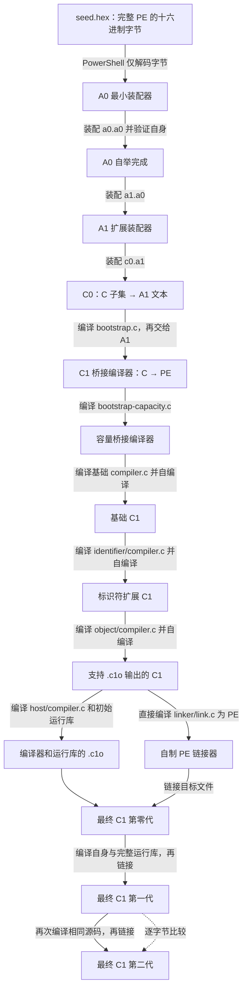

[English](BOOTSTRAP.md) · 简体中文

# 从十六进制种子到 C 编译器

本项目从十六进制机器码文本开始，逐级构建装配器、C 子集编译器、可自编译的 C 编译器和独立 PE 链接器。本页说明构建原理；操作步骤见 [WALKTHROUGH.zh-CN.md](WALKTHROUGH.zh-CN.md)。

## 构建链

箭头表示使用已有工具构建下一级；全部源码均包含在发布包中。下文功能测试属于分阶段或完整构建，默认快速构建只保留生成链与一致性检查，跳过测试分支。



下文源码路径均相对于 `src/bootstrap-c99/`。`stage0`、`stage1`、`stage2` 表示同一级工具的构建代次，不是三种语言版本；不同目录下的 `c1-stage2.exe` 也不是同一个阶段的编译器。

## 1. A0：字节与地址解析

`base/decode_seed.ps1` 将 `base/seed.hex` 的字面十六进制字节解码为 `a0-seed.exe`：一个完整的 3,584 字节 Windows x64 PE 程序。

解码脚本只校验并转换字节，不解析标签、编码指令或生成 PE 结构；这些内容已包含在种子中。

A0 支持原始十六进制字节、数字标签、绝对地址和相对偏移，解析引用后输出二进制字节。

A0 的装配源码是 `base/a0.a0`。种子装配它得到第一代，第一代再装配同一源码得到第二代。构建要求三者逐字节一致；回归验证包含 30 项功能及错误处理测试。

`seed.hex` 是完整机器码的文本表示；`a0.a0` 是需要解析标签和地址的装配源码。

## 2. A1：扩展装配语言

`base/a1.a0` 用 A0 可以处理的形式描述 A1。A0 先装配出 A1，随后 A1 再装配自身两次，比较三份结果。

A1 增加具名标签、字符串、零填充和一小组 x64 指令助记符，供下一层工具使用；它不是完整的 MASM 或 NASM。

## 3. C0：C 子集编译器

`base/c0.a1` 是用 A1 语言编写的 C 子集编译器。A1 将它装配成 `c0.exe`。

C0 将其支持的 C 源码转换为 A1 装配文本，再由 A1 生成可执行程序：

```text
C 源码 ──C0──> A1 装配文本 ──A1──> Windows x64 可执行程序
```

C0 仅实现构建下一层工具所需的 C 子集，不支持完整 C89/C99。

验证分支使用 C0 和 A1 编译 `base/c1/lexer.c` 并测试词法分析结果，后续 C1 重编译同一源码作对照。

## 4. 桥接编译器

两个桥接阶段逐步满足基础 C1 的语言和容量要求：

| 源码 | 使用的工具 | 得到的工具与作用 |
| --- | --- | --- |
| `base/c1/bootstrap.c` | C0 编译，再由 A1 装配 | `c1-bridge.exe`：用受限 C 写成的桥接编译器，可直接输出 PE |
| `base/c1/bootstrap-capacity.c` | 桥接编译器 | `c1-capacity.exe`：扩大输入及代码缓冲等容量，以容纳基础 C1 |
| `base/c1/compiler.c` | 容量桥接编译器 | 基础 `c1-stage0.exe`：进入能编译基础 C1 自身的阶段 |

从桥接编译器开始，C 编译器直接生成机器指令和 PE 文件，无须再经 A1 装配。

基础 C1 第零代编译自身得到第一代，第一代再生成第二代；构建比较后两代，并分别执行功能测试。

## 5. 标识符与目标文件支持

基础 C1 继续分两层扩展：

| 源码 | 构建起点 | 这一层的职责 |
| --- | --- | --- |
| `identifier/compiler.c` | 基础 C1 第二代 | 扩展标识符处理能力，为后续源码提供基础 |
| `object/compiler.c` | 标识符扩展 C1 第二代 | 增加自制 `.c1o` 目标文件输出，支持后续分开编译与链接 |

每层均构建三代并比较后两代。目标文件编译器仍保留直接输出 PE 的能力，用于构建链接器。

`.c1o` 是本项目的目标格式，用来交给自制链接器处理，不是 Windows SDK 的 COFF 目标文件或导入库格式。

## 6. PE 链接器

目标文件输出阶段的两代 C1 分别将 `linker/link.c` 直接编译为 `link-stage1.exe` 和 `link-stage2.exe`，要求两者逐字节一致。

链接器处理 `.c1o` 中的符号与重定位，按指定入口和 DLL 导入生成 PE 可执行程序。

两代链接器一致是两代 C 编译器构建结果的比较；链接器本身不编译 C 源码。

## 7. 最终 C1 与运行库

最终编译器 `host/compiler.c` 与运行库分别编译，再由自制链接器组合：

```text
host/compiler.c ──已有 C1──> compilerN.c1o ─┐
                                         ├─自制链接器─> host/c1-stageN.exe
运行库 C 源码 ─────已有 C1──> runtimeN.c1o ──┘
```

第零代使用上一阶段的目标文件编译器和 `runtime/bootstrap-runtime.c` 构建。

第零代编译自身源码和完整运行库 `runtime/runtime.c`，链接生成第一代；第一代重复此过程得到第二代。

构建同时比较三组结果：

- 第一代与第二代编译器目标文件：`compiler1.c1o`、`compiler2.c1o`。
- 第一代与第二代运行库目标文件：`runtime1.c1o`、`runtime2.c1o`。
- 第一代与第二代最终程序：`c1-stage1.exe`、`c1-stage2.exe`。

一键构建后的最终工具路径：

| 工具 | 相对于发布包根目录的路径 |
| --- | --- |
| 最终 C 编译器 | `src/bootstrap-c99/build-from-seed/host/c1-stage2.exe` |
| 自制 PE 链接器 | `src/bootstrap-c99/build-from-seed/link-stage2.exe` |

用户程序同样采用目标文件加运行库的链接流程。驱动脚本配置方法见 [USAGE.zh-CN.md](USAGE.zh-CN.md)。

## 验证范围

自编译产物一致只能证明构建结果稳定，不能证明行为正确。项目另设功能、非法输入拒绝、运行库、链接和 Windows DLL 导入测试。

分阶段构建不代替完整验收。各模式的测试范围见 [README.zh-CN.md](README.zh-CN.md#构建模式)，验收命令见 [WALKTHROUGH.zh-CN.md](WALKTHROUGH.zh-CN.md)。测试通过不等于完整 C99 符合性证明，能力边界见 [实现约定](src/C89-IMPLEMENTATION.zh-CN.md) 和 [限制](src/C89-LIMITS.zh-CN.md)。

## 脚本、操作系统与自制工具的分工

PowerShell 负责最初的字节解码，以及之后的进程启动、文件流转、源码文本准备、测试和校验；种子之后的二进制由自制工具生成。Windows 提供程序装载和系统 DLL 服务。构建不需要外部 C 编译器、汇编器、链接器或 Windows SDK。

实现入口（相对于 `src/bootstrap-c99/`）：

1. `base/a0.a0`、`base/a1.a0`、`base/c0.a1`：最早的三层工具。
2. `base/build-c1.ps1`：两个桥接编译器与基础 C1 的构建依赖。
3. `build-toolchain.ps1`：标识符、目标文件、链接器及最终 C1 的构建依赖。
4. `compile-program.ps1`：最终工具链如何用于用户程序。

构建模式与环境要求见 [README.zh-CN.md](README.zh-CN.md)。
